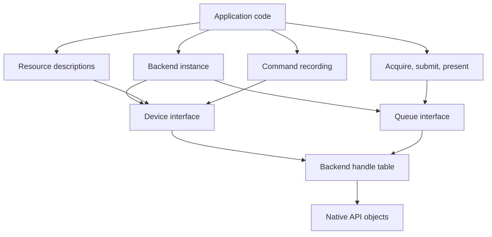

# Project overview

vfrhi is a **render hardware interface** for Zig. It defines a
backend-neutral way to create GPU resources, record rendering and
compute work, submit that work to a queue, and present images. The same
application code can run on Vulkan, OpenGL, Direct3D 11, Direct3D 12,
or the built-in headless test backend.

The name is literal: the project is an interface, not a renderer. It
does not own a window, schedule frames, cache descriptors, or decide
how memory is aliased. Those decisions stay with the application. What
vfrhi provides is a stable vocabulary for the parts that every
low-level graphics API has in common, plus enough validation that a
mistake in that vocabulary is reported instead of silently corrupting
state.

## How the repository is organized

The source tree separates the shared model, the interfaces, the typed
resource wrappers, and the backends. The split matters because only two
types are virtual interfaces; everything else is data or a wrapper
around data.

| Path | Role |
| --- | --- |
| `src/root.zig` | Public entry point. Re-exports the interface types, resource wrappers, backends, and feature flags. |
| `src/Resource.zig` | The shared model: `Version`, `Error`, generational `Resource` handles, resource tags and descriptions, format and pipeline state enums, and the property structs used by queries. |
| `src/Device.zig` | The `Device` interface: its virtual table, raw and convenience wrappers, high-level queries, and device operations. |
| `src/Queue.zig` | The `Queue` interface: its virtual table and wrappers for acquire, submit, present, and idle waits. |
| `src/Command.zig` | The command tagged union and every command parameter struct. |
| `src/resources/` | Typed wrappers such as `Buffer`, `Texture`, `Swapchain`, `GraphicsPipeline`, and `CommandBuffer`. They add cached properties and convenience methods on top of raw handles. |
| `src/backend/test/` | The headless test backend. It implements the same interfaces and validates resource lifetimes, command state, and queue usage without a GPU. |
| `src/backend/vulkan/` | The Vulkan 1.3 backend. |
| `src/backend/opengl/` | The OpenGL 4.5 core backend and its SPIR-V to GLSL translator. |
| `src/backend/dx3d/` | Hand-written Win32, DXGI, D3D11, and D3D12 bindings, plus the SPIR-V to HLSL translator. |
| `src/backend/dx3d11/`, `src/backend/dx3d12/` | The two Direct3D backends, which share the bindings and translator above. |
| `src/tests.zig` | Integration tests. Most run against the test backend; translator tests run without any graphics device. |
| `examples/` | Five independent Zig projects with a shared framework. They demonstrate the same rendering code on every backend. |

Only `Device` and `Queue` are virtual interfaces. A `Buffer`, a
`Texture`, or a `GraphicsPipeline` is a value containing a `Device` and
a generational `Resource` handle. The backend stores the native object
behind that handle.

## Design principles

### A small interface built from data

The device virtual table has ten entries: create, destroy, batch
creation and destruction, map and unmap, queue lookup, command
recording, device operations, and queries. The queue virtual table has
four: acquire, submit, present, and wait for idle. There is no virtual
function per resource kind and no virtual function per command.

Resource kinds are represented by `Resource.Tag` and the
`Resource.Description` tagged union. Commands are represented by the
`Command` tagged union. This **data-driven dispatch** means adding a
buffer-like resource or a new draw command extends the model rather
than the interface. Backends still have to implement the behavior, but
the public surface does not grow one entry point at a time.

The tradeoff is that each backend switches on tags and command kinds.
In exchange, resource descriptions stay backend independent, command
recording has one entry point, and the interface has a small, stable
shape that is easy to reason about.

### Backends live outside the RHI

A backend is a concrete object created by its own API, such as
`Vulkan.init` or `Dx3d12.init`. The RHI never creates or destroys that
object and never reaches back into it through a global. The application
initializes the backend, asks it for a `Device` with `asDevice`, borrows
a `Queue`, and destroys every RHI resource before calling the backend's
`deinit`.

This separation has visible consequences. There is no hidden global
device, no singleton, and no window system requirement inside `src/`.
The application decides which backend exists and for how long. A queue
is a lightweight value that borrows the backend; it has no independent
lifetime. A resource handle only means something to the device that
created it.

### Ownership is explicit and manual

Handles are **generational**. A handle carries a slot index and a
generation counter, plus a tag that names the resource kind. When a
resource is destroyed, the generation advances, so every copy of the
old handle becomes stale. Backends check the index, generation, and tag
before using a handle, so a stale or wrong-type handle is rejected
instead of reaching the native API. A handle cannot encode the device
that created it, which is why handles must never cross a device
boundary.

There is no reference counting and no automatic cleanup. Resources are
destroyed in reverse dependency order, either one at a time or through
the batch helpers. The test backend records the dependency edges it
knows about and rejects destruction while a dependent resource is still
alive. Native backends rely on the same rule and report invalid handles
where the native API allows it.

Every low-level interface function has a **`raw` form** that accepts an
explicit return address, and a convenience form that supplies
`@returnAddress()`. Typed resource wrappers follow the same pattern with
`WithAddr` variants. The return address is diagnostic only. It lets a
backend attribute a leak or a rejected call to the caller without
changing program behavior.

### SPIR-V is the only shader input

Shaders enter the RHI as **SPIR-V modules**. The Vulkan backend consumes
them directly. OpenGL and Direct3D cannot, so their backends translate
the module to GLSL 4.50 or HLSL 5.x and compile it with the platform
compiler. Translation is part of the backend, not an optional tool in
the application.

Both translators cover a deliberately demonstrated subset of SPIR-V.
When a module uses an instruction or feature outside that subset, the
backend returns `error.Unsupported`. It does not silently emit a shader
with different semantics. This rule is what makes it reasonable to
write one shader and expect the same visual result across backends.

The examples express shaders as Zig source and compile them to
`spirv32-vulkan` in their own build scripts. That choice keeps the
examples free of an external shader compiler, but the RHI itself
accepts any SPIR-V producer.

### The window system is not part of the RHI

Nothing under `src/` creates a window, an OpenGL context, or a message
loop. A surface is described by native handles supplied by the caller,
or by a headless width and height. Vulkan accepts Win32, Xlib, and
Wayland handles. Direct3D accepts a Win32 `HWND`. OpenGL works with the
current context and does not need a native handle at all.

Presentation reflects the same split. Vulkan and Direct3D present
through their native swapchains. OpenGL cannot present portably, so its
backend blits into the default framebuffer and leaves the actual buffer
swap to the caller. The application always owns the window and the
platform event loop.

### Validation is part of the product

The test backend is not an afterthought. It implements the same
`Device` and `Queue` interfaces as the GPU backends and validates
resource generations, destruction order, mapping state, command buffer
state, descriptor writes, queue submissions, and presentation
parameters. It also stores shadow bytes for buffers and textures, so a
test can assert that uploaded data arrived intact.

This makes the test backend a practical **executable specification**.
Library code that creates resources and records commands can run
unchanged in a unit test with no GPU, no display, and no driver. When a
native backend and the test backend disagree about valid usage, the
test backend is usually the clearer statement of the intended contract.

## Execution model

An application follows a simple path from backend creation to
presentation. The backend owns native objects; the interfaces translate
abstract handles and commands into calls on those objects.

Resource creation and destruction go through the device. Command
recording also goes through the device, one command per call. Acquire,
submit, and present go through the queue. Reads of device capabilities,
such as limits, format support, memory heaps, and surface properties,
also go through `Device.query` and its typed getters.

## Scope and non-goals

vfrhi is intentionally narrower than a rendering engine. It does not
provide a **render graph**, a **frame scheduler**, a **descriptor
cache**, an **asset pipeline**, or a **math library**. It does not hide
synchronization behind implicit barriers, and it does not choose
memory placements for the application beyond honoring the requested
memory hints.

It is also not a runtime backend loader. Backends are selected at build
time. Applications that want runtime selection typically keep a union
of the compiled backends and dispatch at their own boundary, as the
examples do.

The project is **pre-1.0**. The interface may change between releases
when a change makes the backend contract clearer or removes a lie about
portability. The [backends guide](backends.md) records the current
behavior and limitations, and the [usage guide](usage.md) explains the
ownership rules that are not encoded in the type system.
